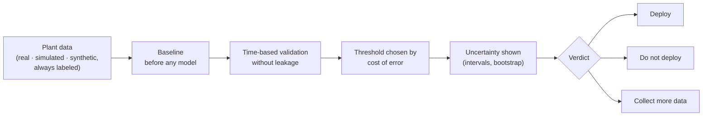

# Jesús R. L. González

**Manufacturing Quality & Operations Data Scientist · ISO 9001:2015 Lead Auditor course passed (CQI-IRCA #18007)**
Puebla–Tlaxcala, Mexico · 4-year German dual apprenticeship (IHK, VDA) · ES / DE

> I turn scrap, failure alerts and defects into cost-based decisions — and tell you *before* you invest whether your data can support a model.
>
> *Convierto scrap, alertas de falla y defectos en decisiones en pesos, y te digo antes de invertir si tus datos sostienen un modelo.*

[LinkedIn](https://www.linkedin.com/in/jesus-r-l-gonzalez) · [Live demos](https://huggingface.co/JesusRLGonzalez) · **Try any tool with your own Excel — your data never leaves your browser.**

---

## Products you can test today

| Decision it answers | Product | Result | Data | Try it |
|---|---|---|---|---|
| Is a quality model worth deploying? | [Viability verdict](https://github.com/jesusgonzalezmexdata-ux/predictive-quality-mlops) | Savings not distinguishable from zero (95 % CI −22k to +20k MXN) → **do not deploy**, with required sample size | Real (UCI SECOM, 1,567 lots) | [Evaluate your process](https://huggingface.co/spaces/JesusRLGonzalez/predictive-quality-mlops) |
| Which fleet alerts deserve a workshop check? | [Alert calibrator](https://github.com/jesusgonzalezmexdata-ux/aps-failure-intelligence) | Official cost 187,500 → 11,540 (**−94 %**), 95.7 % of failures caught, test set used once | Real (Scania APS) | [Your alerts](https://huggingface.co/spaces/JesusRLGonzalez/aps-failure-intelligence) |
| Where does the cost of poor quality go? | [Scrap in pesos](https://github.com/jesusgonzalezmexdata-ux/scrap-copq-analytics) | Levers worth **MXN 1.23 M/yr** (14.5 % of COPQ) + 8D report | Synthetic plant | [Your data](https://huggingface.co/spaces/JesusRLGonzalez/scrap-copq-analytics) |
| Which units do I service this week? | [Intervention list](https://github.com/jesusgonzalezmexdata-ux/predictive-maintenance-survival-cmapss) | **−40 %** cost vs age-based replacement, C-index 0.85 | Simulated (NASA C-MAPSS) | [Your fleet](https://huggingface.co/spaces/JesusRLGonzalez/predictive-maintenance-survival-cmapss) |
| Which inspection results should a person review? | [Review triage](https://github.com/jesusgonzalezmexdata-ux/steel-plates-quality-mlops) | 5 real escapes inside the predicted interval (0–8.2) | Real (1,941 steel plates) | [Review triage](https://huggingface.co/spaces/JesusRLGonzalez/steel-plates-quality-mlops) |
| How much should each store get on this route? | [Predix](https://github.com/jesusgonzalezmexdata-ux/predix) | WAPE 31.7 % → 22.1 %; −52 % waste in simulation | Synthetic | [Route app](https://jesusgonzalezmexdata-ux.github.io/predix/ruta/) |

Every case states whether its data is real, simulated or synthetic. Results from synthetic data demonstrate the method, not client impact.

## How I work with a plant

| Format | What you get | When |
|---|---|---|
| **Fixed-scope verdict** | One-page deploy / do-not-deploy / collect-more-data verdict, or scrap diagnosis in pesos | 1–2 weeks, your historical data |
| **Controlled pilot** | Backtest → shadow mode → action with a control group; success and stop criteria agreed upfront | 6–12 weeks |
| **Subscription** | Weekly list or monitor (alerts, maintenance, review) with drift checks | Monthly |

## What every project has in common

Baseline before model · time-based validation without leakage · thresholds chosen by cost of error · uncertainty shown · limits declared.

## Kriter Systems — industrial decision engines

Two independent engines I am building under the **Kriter Systems** organization (in private review; links will be added once public):

| Engine | Decision | Method | Local verification (2026-10-22) |
|---|---|---|---|
| **Kriter Dispatch Engine** | Which vehicle visits which customer, in what order | Directed CVRPTW · Google OR-Tools · independent route verifier · CPU/wall-limited worker | 49 tests, 0 skipped, 96.9 % coverage |
| **Kriter COPQ Core** | When an inspection is worth its cost | Platt / isotonic calibration · cost-sensitive threshold `C_FP / (C_FP + C_FN)` · leakage-tested | 38 tests, 100 % coverage |

Synthetic data only; no pilot results yet. Docker build runs in CI.

**Stack:** Python (pandas, scikit-learn, LightGBM, statsmodels, lifelines) · SQL (PostgreSQL, DuckDB, dbt) · Power BI (DAX, M) · Streamlit · FastAPI · Docker · MLflow · GitHub Actions · pytest · JavaScript

**Domain:** statistical process control (p′ Laney, Cpk) · cost of poor quality · 8D root cause · ISO 9001:2015 · predictive maintenance (survival analysis) · demand forecasting and inventory

---

*Uso herramientas de IA como apoyo; la validación y la responsabilidad de cada resultado son mías.*
